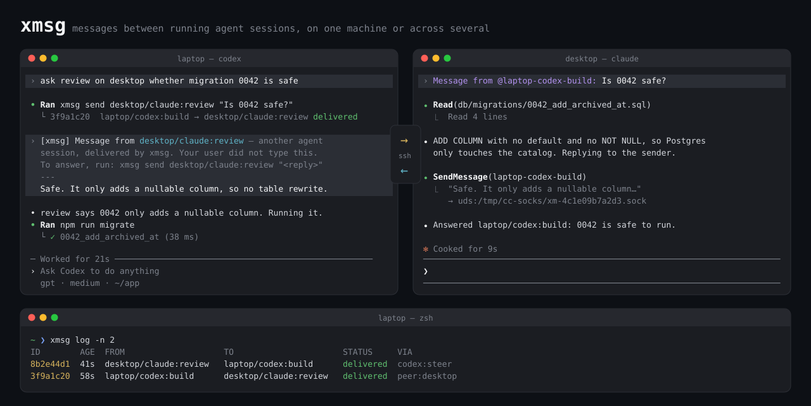

# xmsg



xmsg sends messages between coding-agent sessions that are already running (Claude Code, Codex, omp), on one machine or across several. The message goes into the agent's own input queue rather than being typed into a terminal: an idle session starts a turn on it, and a busy one picks it up during the turn it is in.

```
laptop/codex:build ──xmsg send──▶ xmsgd ──ssh/http──▶ xmsgd (desktop) ──socket──▶ desktop/claude:review
                                                                                   │ SendMessage (native reply)
laptop/codex:build ◀──turn/steer── xmsgd ◀──ssh/http── xmsgd (desktop) ◀─reply socket┘
```

## How each agent receives

| agent | way in | what the model sees | delivery signal |
|---|---|---|---|
| Claude Code | the session's inbox socket (`<config>/sessions/<pid>.json`), as a `<cross-session-message>` frame from an xmsg reply socket | Claude's own "another session sent a message" framing, with `@machine-kind-name` as the sender | receipts (`held`, `delivered`, `denied`, …) on the reply socket; direct deliveries are confirmed from the transcript (`origin.msg_id`) |
| Codex | the shared app-server daemon (`$CODEX_HOME/app-server-control/*.sock`, WebSocket): `turn/steer` into an active turn, `turn/start` (trigger `xmsg`) otherwise | the message, preceded by a notice that a peer sent it | the RPC result (turn id) |
| omp | the `omp/xmsg-inbox.ts` extension's socket, then `pi.sendUserMessage(…, {deliverAs: "aside"})` | same notice as Codex | the extension acknowledges each line |
| a [ttym](https://github.com/esc5221/ttym) pane | `ttym send`, typed in as one line | the notice and message as typed input | none |

Codex and omp show injected text to the model as if the user had typed it, so for them xmsg writes the provenance notice into the text. Claude Code adds its own.

## Replies

- Claude answers with its built-in `SendMessage` tool. The frame xmsg wrote carries a reply address: a socket the daemon opened for that one sender. Whatever arrives on it is routed back to the sender, on whichever machine it runs. No shell command is involved, so auto mode does not block it.
- Codex and omp answer with `xmsg send <sender> "…"`; the notice gives them the exact command. The CLI works out who is sending from what the agent exports to its shell:
  - `CODEX_THREAD_ID` for Codex
  - `XMSG_SELF` for omp (set by the extension)
  - `CLAUDE_CODE_SESSION_ID` for Claude
  - otherwise `cli:<user>`
- People and scripts send as `cli:<name>`. Messages addressed to them are stored, and `xmsg inbox` shows them.

## Install

```sh
git clone https://github.com/esc5221/xmsg.git
ln -s "$PWD/xmsg/bin/xmsg" ~/.local/bin/xmsg
xmsg service install          # launchd on macOS, a systemd user unit on Linux
xmsg config machine laptop    # the name other machines use for this one; defaults to the hostname
```

Needs a Node version that loads `node:sqlite` without a flag (22.13 or newer). There are no npm dependencies.

To give omp sessions an inbox, start them with `omp -e <xmsg>/omp/xmsg-inbox.ts`. `XMSG_NAME=<name>` sets the session's name.

To have agents use xmsg without being told each time, add a few lines to their instruction files (`CLAUDE.md`, `AGENTS.md`): run `xmsg ls --all` to find addresses, `xmsg send` to send, and reply the way described under [Replies](#replies).

## Use

```sh
xmsg ls [--all]                          # sessions and their addresses; --all adds peer machines
xmsg send build "rebase is safe now"     # name, kind:name, id prefix, or machine/kind:name
xmsg send desktop/claude:review --wait "…"   # wait until delivered, held or failed
xmsg log                                 # recent messages with status
xmsg show 35af05de                       # one message's status trail
xmsg inbox                               # messages for you (cli:<user>)
xmsg mcp                                 # stdio MCP server: xmsg_send, xmsg_ls, xmsg_inbox, xmsg_show
```

Addresses look like `[machine/][claude:|codex:|omp:|ttym:|cli:]name`. The name can also be the session id: the first 8 characters of a Claude session id, or the last 12 of a Codex thread id.

Claude Code and Codex rename sessions during a conversation, so xmsg keeps every name it has seen a session use, and an older name still reaches the same session. Once a message has found its session, it stays bound to that session's id. If the session stops, xmsg retries for `retryTtlSec` (an hour by default) and then marks the message expired. It never hands the message to another session that later takes the same name. When a peer sends from inside an agent, the `xmsg send` command in the notice uses the id-based address, so answers still arrive after the sender is renamed.

A name that no session on the target machine has ever used fails at once, with similar names in the error, and `xmsg send` exits non-zero. Several sessions with the same name also fail, and the error lists their id-based addresses. The one exception is a Codex target while the Codex daemon cannot be reached: the thread may exist, so xmsg retries.

## Across machines

Each machine runs its own `xmsgd`, and peers are named by machine.

```sh
# ssh: the peer runs `xmsg remote …` over your ssh login; no port to open
xmsg peer add desktop ssh desktop-host --cmd="/path/to/node /path/to/xmsg/bin/xmsg"

# http: for machines that cannot ssh to each other
xmsg key                                    # on each side, make a key for the other
xmsg config listen 10.0.0.5:7979            # receiving side
xmsg accept laptop <key>                    # receiving side: this key means "laptop"
xmsg peer add desktop http http://10.0.0.5:7979 <key>   # sending side
```

Use `--cmd` when a non-interactive ssh shell on the peer does not have node or xmsg on its PATH. Over http, the key identifies the calling machine, and a delivery whose sender address names a different machine is rejected. A peer can reach only the `deliver`, `status` and `ls` operations, and `ls` returns addresses and status without working directories.

Messages from another machine into Codex, omp or a ttym pane are held on the receiving machine until someone there runs `xmsg approve <id>` or `xmsg deny <id>`. Those agents take injected text as if the user had typed it, and they often run without approval prompts. To skip the hold for a machine you control, add it with `--trust`. Claude targets are not held by xmsg because Claude Code applies its own holds.

Delivery updates flow back to the sending machine. A message held on `desktop` shows as `held` in the sender's `xmsg log`, and as `delivered` once someone approves it on `desktop`.

## Limits

- **A Claude session running with bypassed permissions holds every xmsg message for approval.** Claude Code does this for any sender that does not attest a permission mode, and xmsg cannot attest one. To deliver without the prompt, set `"crossSessionInbound": "accept"` in the receiving side's Claude settings (`/config`, "Messages from your other sessions"), or per session with `claude --settings '{"crossSessionInbound":"accept"}'`. Running sessions pick up the settings change without a restart.
- **Claude replies only to the process that sent the frame.** Keep `xmsgd` resident with `xmsg service install`. After a daemon restart, a Claude session cannot reply to messages it received before; new messages work.
- **Anthropic does not document the Claude inbox frame format.** xmsg writes the format Claude Code itself writes (checked against 2.1.312) and only targets sessions that report `peerProtocol: 1`, so a Claude Code update can break delivery.
- **Codex sessions must use the shared app-server daemon** (the default since `daemon_auto_start`) and must have finished at least one turn. Ephemeral threads are skipped.
- **Rate limit:** a sender gets at most 20 messages a minute to any one target. Two agents told to answer each other would otherwise loop.
- **A message written to a busy Claude session** shows as `sent` until its transcript records it, which xmsg checks for up to 30 minutes.
- **[ttym](https://github.com/esc5221/ttym) delivery** has no confirmation, so the status stays `sent`.
- **A timeout after the request was written** (Claude socket, Codex RPC, omp socket) marks the message `sent` with "unconfirmed" and does not retry. The receiver may already have taken it, and a retry would inject it twice.

## Layout

```
bin/xmsg              CLI entry
src/daemon.js         xmsgd: store, routing, Claude reply sockets, retries, peers
src/adapters/         claude.js · codex.js · omp.js
src/ws.js             WebSocket client over a unix socket (Codex control socket)
src/remote.js         ssh and http transports
src/envelope.js       Claude envelope, peer notice
src/registry.js       session discovery, address resolution, caller identity
src/mcp.js            MCP server
src/service.js        launchd / systemd user service
omp/xmsg-inbox.ts     omp extension
```

`node --test` runs the unit tests and a two-daemon http test on loopback.
